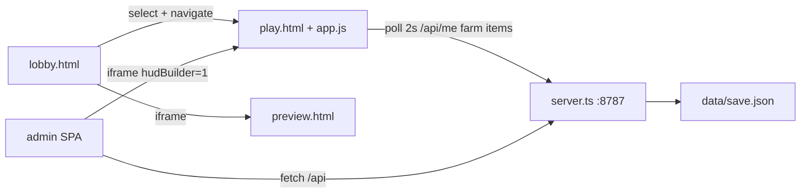

# 01 — Arquitetura

## 1. Estrutura de pastas relevantes

```
JogoIDLE/
├── package.json              # Véu de Cinzas (Vite+Phaser+React) — irmão
├── src/ public/ dist/        # Cliente Véu de Cinzas
├── docs/                     # GDD, capítulos, balanceamento, HUD
├── idle/                     # ★ Jogo IDLE standalone
│   ├── package.json          # express + tsx
│   ├── src/
│   │   ├── server.ts         # HTTP + rotas + static
│   │   ├── local-service.ts  # gameplay local (user fixo)
│   │   ├── admin-service.ts  # admin + assertIdleAdmin
│   │   └── store.ts          # JSON save
│   ├── data/save.json        # persistência ativa
│   ├── lib/jogo-idle/    # domínio TS (game/, content/, hud-*)
│   │   └── service.ts        # legado Prisma — NÃO usado pelo standalone
│   ├── public/jogo-idle/ # cliente HTML/JS + assets + admin build
│   ├── admin-ui/             # fonte React do Admin Studio
│   └── scripts/balance-audit/
└── AUDITORIA_JOGO_IDLE/  # este pacote
```

Evidência: `idle/README.md`, listagem do repositório.

## 2. Stack e versões

| Camada | Tecnologia | Evidência |
|--------|------------|-----------|
| Servidor IDLE | Express `^5.1.0`, Node via `tsx ^4.20.5`, TypeScript `~6.0.3` | `idle/package.json` |
| Admin UI | React `^19.1.1`, Vite `^7.1.7`, Tailwind `^4.1.13`, Radix | `idle/admin-ui/package.json` |
| Cliente jogo | HTML + ES modules (sem bundler no play) | `idle/public/jogo-idle/play.html` |
| 3D | Three.js **REVISION `170`** vendored | `idle/public/jogo-idle/vendor/three/` |
| Root monorepo | Phaser `^4.2.1`, React `^19.3.1`, Vite `^8.3.4` | root `package.json` |

**Não encontrado no standalone:** Next.js, Prisma schema, SQLite, Docker, `vercel.json`.

## 3. Backend

- **Entry:** `idle/src/server.ts` — `PORT || 8787`, `express.json({ limit: "2mb" })`, `x-powered-by` off.
- **Static:** `/jogo-idle` → `idle/public/jogo-idle`; admin SPA `/jogo-idle/admin/`.
- **Redirects:** `/` e `/jogo-idle` → `lobby.html`.
- **Handlers:** gameplay → `local-service.ts`; admin → `admin-service.ts`; persistência → `store.ts`.

### Autenticação (standalone)

| Aspecto | Estado | Evidência |
|---------|--------|-----------|
| Cookies / sessão | **Não encontrado** | Sem middleware de session em `server.ts` |
| Usuário | Fixo `LOCAL_USER_ID = 1`, `LOCAL_USER_EMAIL = "local@idle.local"` | `local-service.ts` |
| Admin | `assertIdleAdmin(email)` + allowlist (`admin.ts` / env `JOGO_IDLE_ADMIN_EMAILS`) | `admin-service.ts` |
| Cliente | `fetch(..., { credentials: 'include' })` | `app.js` — cookies não são emitidos pelo server standalone |

## 4. Persistência

Arquivo: `idle/data/save.json` via `idle/src/store.ts`.

Top-level (`SaveFile`):

- `characters[]` — `CharacterRow` (id, userId, name, classId, level, experience, gold, isActive, **state** blob, timestamps)
- `catalog` — dropChance, deletedIds, overrides (`__world`, `__merchant`, `__hud`, …)
- `adminActions[]` — audit log
- `fame` — agregados Galeria da Fama (local)

**Prisma:** referenciado em `lib/jogo-idle/service.ts` — **legado**, fora do path standalone (`idle/README.md`).

## 5. APIs (`/api/jogo-idle/*`)

Todas declaradas em `idle/src/server.ts` (sem routers separados).

| Grupo | Exemplos | Status |
|-------|----------|--------|
| Meta | `GET meta`, `GET announcements` | Implementado |
| Personagens | `GET/POST characters`, `POST :id/select`, `DELETE :id`, appearance | Implementado |
| `me` | `GET me`, attributes, skills, combat-skills, pets, auto-hp, hunt-perf | Implementado |
| Farm | `POST farm/start\|stop\|auto-restart` | Implementado |
| Itens / mercador | `POST items/:op`, `POST merchant/buy` | Implementado |
| Capítulos / journey / fame | `GET chapters`, `POST chapters/enter`, journey, fame/* | Implementado |
| Ascensão | `POST me/ascend` | Implementado |
| Admin | config, grant, catalog, character, season/end, simulate, world-snapshot | Implementado (gate allowlist) |
| HUD | `GET hud-layout`; admin draft/publish/restore/history | Implementado (API); UI publish parcial |
| Ranking / seasons | `GET ranking`, `GET seasons` | **Stub** — arrays vazios |
| Arena | `ALL arena/*` | **501** |
| Engagement | `POST engagement/claim` | **410** |

## 6. Frontend e comunicação



- Lobby cria/seleciona personagem; **Jogar** faz `POST .../select` e navega para `play.html` (full reload).
- `app.js`: `apiPath()` mapeia `/api/*` → `/api/jogo-idle/*`; `POLL_MS = 2000`.
- Admin: build em `public/jogo-idle/admin/`; dev Vite **5174** com proxy `/api` → 8787 (`admin-ui/vite.config.ts`).

## 7. Three.js e assets

| Peça | Path |
|------|------|
| Arena lazy | `arena.js` → `import('./scene3d.js')` |
| Cena combate | `scene3d.js` |
| Props de zona | `kaykit-props.js` — `preloadKayKitProps(kind)`, `buildKayKitZone` |
| Personagens | `/jogo-idle/assets/models/` |
| Packs | `assets/kaykit/*`, `props/*`, `kenney/*`, `quaternius/space/` |

Packs Kenney/Quaternius: registrados em `kaykit-props.js` (`kenneyGraveyard`, `kenneyNature`, `quaterniusSpace`) — ver `assets/ASSETS-ROADMAP.md`.

## 8. Deploy / infraestrutura

| Item | Status |
|------|--------|
| Dockerfile / compose | **Não encontrado** |
| vercel.json | **Não encontrado** |
| Runbook local | `idle/README.md`, root `README.md` (`dev:idle`) |
| Spec futura Fastify+Postgres | `docs/ESPECIFICACAO_TECNICA.md` — **Planejado**, não é o runtime atual |

## 9. Dualidade monorepo

| Projeto | Runtime | Persistência |
|---------|---------|--------------|
| Jogo IDLE | Express `:8787` | `idle/data/save.json` |
| Véu de Cinzas | Vite `:5173` | `localStorage` (doc root README) |

Não compartilham API.
