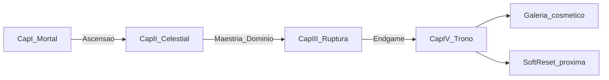

# 17 — Visão: Temporada de 120 dias

**Status:** proposta Progressão 3.0 (estudo). **Não implementado.**  
**Dados:** `data/scenario_C_params.json`, `data/v3_capitulos.csv`, `data/v3_perfis_120d.json`.

---

## Regra atual

- Temporadas existem no motor (`season.ts`, slug `{ano}-T{trimestre}`).
- Soft reset sazonal (`softResetCharacterForSeason`) zera nível/ouro/inv/ascensão competitiva; preserva journey vitalícia e `ascensionLegacy`.
- Progressão de conteúdo é contínua: 17 regiões, caps Mortal 500 / Celestial 700.
- Não há capítulos sazonais, campanha de 4 meses nem definição formal de “conclusão de temporada” além do reset.

## Proposta 3.0

O Sinergia IDLE na plataforma maior deve **incentivar retorno regular** com ~**120 dias** de oportunidades relevantes — sem exigir 120 dias de grind ininterrupto.

| Conceito | Definição |
|----------|-----------|
| Tempo de calendário | Dias reais da temporada (1–120) |
| Tempo conectado | Minutos/horas com o jogo aberto |
| Tempo recompensado | Horas efetivamente creditadas pelo motor (online + offline) |

**Nível 500 Mortal** = fim da **primeira grande fase** (Capítulo I), não fim da temporada.  
**Alcançar o cap de nível** ≠ **concluir todo o conteúdo**.

---

## Quatro capítulos (ritmo, não hard-lock)

Datas são **referência de ritmo**. Conteúdo principal permanece acessível a late-join; eventos semanais podem ter janelas suaves com catch-up de **recompensa** (não de ranking competitivo).

| Cap. | Nome | Dias | Objetivos principais |
|------|------|------|----------------------|
| I | Era Mortal | 1–30 | 1→500, regiões mortais, build, refine, chefes, prep ascensão |
| II | Despertar Celestial | 31–60 | Ritual, Celestial early/mid, gear divino, chefes especiais |
| III | Ruptura dos Reinos | 61–90 | Celestial →700, Maestria, dimensões, builds niche |
| IV | Trono dos Deuses Antigos | 91–120 | Domínio alto, chefes finais, rankings, cosmético, opcionais |

---

## O que significa concluir a temporada

Proposta canônica (Cenário C):

1. Alcançar marcos principais (Ascensão + Celestial 700 + Maestria mínima).
2. Concluir a campanha sazonal (checklist de capítulos).
3. Derrotar o chefe final (`trono_antigos` / cadeia endgame).
4. Registrar conclusão na Galeria da Fama.
5. Receber cosmético exclusivo da temporada.

O **ranking competitivo** continua até o dia 120. Quem concluiu cedo permanece em desafios opcionais (domínio alto, leaderboards de TTK, artefatos).

### Transição entre temporadas

| Persistente | Resetado (competitivo) |
|-------------|------------------------|
| Journey vitalícia / feitos históricos | Nível, XP, ouro |
| Cosméticos de temporada anteriores | Inventário / equipamento sazonal |
| `ascensionLegacy` / títulos de fama | Ascensão ativa, farm, carreira sazonal |
| Estatísticas lifetime Galeria | Buckets de temporada atual |

Alinhado ao soft reset já existente; Progressão 3.0 só **documenta a política** e acrescenta cosmético + checklist de conclusão.

---

## Late-join e recuperação

- Sem bloqueio temporal no conteúdo principal (regiões/chefes/maestria).
- Offline proposto (8 h com decay) permite recuperação sem “ficar online o dia todo”.
- Missões semanais: janela + catch-up parcial na semana seguinte.
- Rankings: late-join compete no restante do prazo; não há equalização artificial de score.

---

## Integração com a plataforma (proposta)

| Sistema | Papel | Evitar |
|---------|-------|--------|
| Eventos de temporada | Marcos Cap.I–IV, boss world | Punição por ausência |
| Missões semanais | Rotação leve, ouro/mats | Daily obrigatório punitivo |
| Desafios comunitários | Meta coletiva opcional | Travar progresso solo |
| Rankings por categoria | Nível, maestria, domínio, TTK chefe | Um único ranking absoluto |
| Recordes de chefes | Galeria / hall | Exigir clique em combate |
| Cosméticos | Conclusão + top ranking | Pay-to-win de poder |
| Retrospectiva | Fim de temporada | Apagar história do jogador |

---

## Premissas reavaliadas (Cenário B → temporada)

| Métrica | Cenário B (Prog 2.0) | Leitura 3.0 |
|---------|----------------------|-------------|
| Guerreiro opt →500 | ~26 h | Cap.I — ok como fase 1 |
| Casual →500 | ~54 h | Cap.I em ~2 semanas de calendário com offline |
| Celestial →700 (só XP) | ~19 h | **Insuficiente** para Cap.II–III; C usa gates de conteúdo (~45–140 h) |
| Regiões | 17 | Expandir para **32** (doc 19) |
| Offline | 2 h / 5k ticks | Proposta **8 h + decay** (doc 18/22) |
| Pós-700 | Inexistente | **Maestria + Domínio** (doc 21) |

---

## Links

- [18_PROGRESSAO_EXPONENCIAL.md](18_PROGRESSAO_EXPONENCIAL.md)
- [19_EXPANSAO_REGIOES_E_ENDGAME.md](19_EXPANSAO_REGIOES_E_ENDGAME.md)
- [22_SIMULACAO_TEMPORADA_COMPLETA.md](22_SIMULACAO_TEMPORADA_COMPLETA.md)
- [23_PLANO_PROGRESSAO_3_0.md](23_PLANO_PROGRESSAO_3_0.md)
