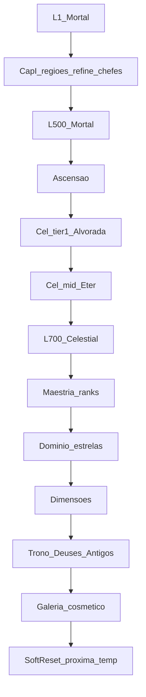

# 23 — Plano Progressão 3.0 (canônico)

**Status:** proposta completa para aprovação. **Zero alteração de produção nesta etapa.**  
**Params:** `data/scenario_{A,B,C,D}_params.json` · **Agregados:** `data/v3_cenarios.{csv,json}`.

---

## Comparativo A / B / C / D

| | A Atual | B Prog 2.0 | C Prog 3.0 temporada | D Prog 3.0 competitivo |
|--|---------|------------|----------------------|------------------------|
| XP→500 | 96.7M | 103.4M | =B | =B |
| Guer. opt→500 | 12 h | **26 h** | 26 h (Cap.I) | 26 h |
| Guer. casual→500 | 19 h | **54 h** | 54 h | 54 h |
| Cel→700 | ~7 h XP | ~19 h XP | **~45 h+** c/ gates | **~55 h+** |
| Temporada | — | — | **120 d** | **120 d** |
| Regiões | 17 | 17 | **32** | 32 |
| Offline | 2 h | 2 h | **8 h decay** | 8 h decay |
| Pós-700 | — | gap tier-1 | **Maestria 40 + Domínio 5** | **Maestria 60 + Domínio 7** |
| Risco | Rush | Ok Cap.I só | Escopo conteúdo | Escopo + balance fino |

**Recomendação de direção:** adotar **C** como base de temporada; usar **D** como pacote opcional de endgame após C estável.

---

## Proposta canônica: do L1 Mortal ao fim do endgame sazonal



### Capítulo I (d1–30) — Era Mortal

1. Progressão Cenário **B** (H2, B-det, gearPowerFraction 0.32).
2. 14 regiões mortais + Prova Divina.
3. Meta: L500 + prep Suco + ritual gold.
4. Calendário sim: Casual ~d14 L500; Competitivo ~d4.

### Capítulo II (d31–60) — Despertar

1. Ritual (gear/attrs mantidos).
2. Seis zonas celestial early (incl. Éter ajustado).
3. Gear divino / cel t1–t3; sinks Cap.II.
4. Sem time-gate duro — late-join ascende quando pronto.

### Capítulo III (d61–90) — Ruptura

1. Celestiais avançadas + caminho →700.
2. Abrir **Maestria** e **Domínio**.
3. Dimensões Crepúsculo / Forja.
4. Builds niche (resist, interval, survival).

### Capítulo IV (d91–120) — Trono

1. Dim Labirinto / Vazio; Trono → Coração → Salão.
2. Conclusão oficial + cosmético + Galeria.
3. Ranking até d120; opcionais para quem fechou cedo.
4. Soft reset: política doc 17/21.

---

## Fórmulas / premissas (resumo)

| Sistema | Atual | Proposta C |
|---------|-------|------------|
| XP mortal/cel | piecewise motor | smooth_B no Cap.I (herança B) |
| Mob XP/nível | 20 | 15 (B) |
| Offline | 2 h / 5k ticks | 8 h / ~12k ticks + decay |
| Poder | ~1e3–1e5 | até ~5e14 Cap.IV c/ TTK alvo |
| Pós-700 | — | ranks Maestria + estrelas Domínio |

Detalhe numérico: docs 18–22 e JSONs `v3_*`.

---

## Riscos

| Risco | Mitigação |
|-------|-----------|
| Escopo 15 regiões novas | Fases: tier-1 cel primeiro; dims depois |
| Números enormes ilegíveis | Abreviação pt-BR (doc 18) |
| Offline 8 h “quebra” competitivo | Decay 40% no final da banda |
| Cap.I ainda “rápido” em calendário | Intencional — Cap.II–IV carregam a temporada |
| Drop live 0.016 | Calibrar loot sazonal separado do XP |
| Complexidade Maestria+Domínio | Ship Maestria 20 ranks MVP → 40 |

---

## Gate de implementação futura (não executar agora)

Ordem sugerida **após aprovação explícita**:

1. Offline 8 h + decay (só params de catch-up).
2. Parâmetros Cenário B no motor (Prog 2.0).
3. Zonas Celestial L1 (conteúdo mínimo).
4. Maestria + Domínio (sistemas novos).
5. Regiões Cap.III–IV + economia sinks.
6. Checklist conclusão + cosmético + Galeria.
7. Pacote D (ranks extras, affixes, leaderboards).

**Fora deste documento:** alterar combate, saves, migrações ou balance live **sem** novo sign-off.

---

## Como regenerar simulações

```bash
cd idle && node scripts/balance-audit/run-v3-season.mjs
```

Escreve apenas `docs/balanceamento/data/v3_*`.

---

## Índice Progressão 3.0

| Doc | Tema |
|-----|------|
| [17](17_VISAO_TEMPORADA_120_DIAS.md) | Visão 120 dias / capítulos / conclusão |
| [18](18_PROGRESSAO_EXPONENCIAL.md) | Poder, Number, offline |
| [19](19_EXPANSAO_REGIOES_E_ENDGAME.md) | 32 regiões |
| [20](20_ECONOMIA_E_EQUIPAMENTOS_SAZONAIS.md) | Economia / gear |
| [21](21_CELESTIAL_E_POS_ASCENSAO.md) | Celestial / Maestria |
| [22](22_SIMULACAO_TEMPORADA_COMPLETA.md) | Perfis 120 d |
| [23](23_PLANO_PROGRESSAO_3_0.md) | Este plano |

Prog 2.0 preservada: [14](14_PROGRESSAO_2_0.md), [15](15_COMPARATIVO_CENARIOS.md), [16](16_PLANO_IMPLEMENTACAO.md).
