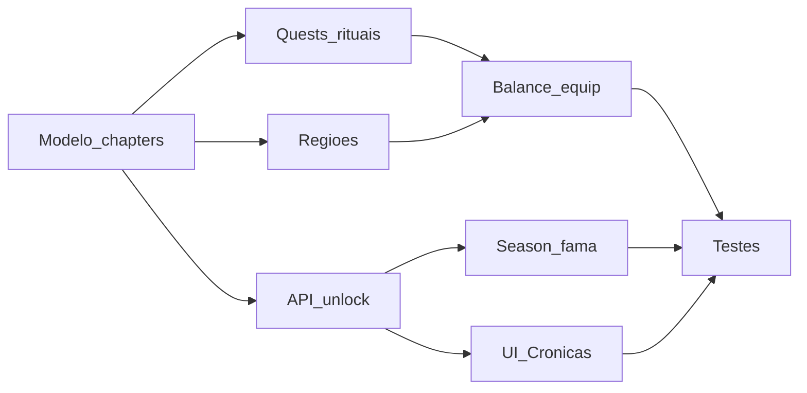

# 08 — Impactos no projeto

**Status:** mapa de módulos. **Sem alterações de código nesta etapa.**

---

## Regra atual (módulos tocados pelo progresso)

Motor de combate, personagem, inventário, equipamentos, habilidades, refine, monstros/zonas, catálogo Admin, ranking, Galeria/journey/temporadas, offline catch-up, API `/me`, HUD play, seleção de região, lobby.

## Proposta — matriz de impacto

| Módulo | Impacto | Tipo de mudança | Dependência |
|--------|---------|-----------------|-------------|
| `game/balance.ts` | Caps por capítulo; bands | params | Flag |
| `game/character.ts` | blob chapters; rituais N; soft reset dual | core | 07, 09 |
| `game/combat.ts` | gates chapter; stop on switch; pity hooks | core | 03, 04 |
| `game/data.ts` / content | 20 zonas + chapterId | data | 03 |
| `game/inventory.ts` / items | gearChapter soft-cap; questBound | core | 06 |
| Skills / pets | gates por classificação | médio | 05 |
| Refine | B-det + temático | params | 06 |
| `journey.ts` / `fame.ts` | eventos ritual Divino/Semideus; conclusão Cap.IV | médio | 04 |
| `season.ts` / soft reset | season vs legacy chapters | core | 01, 07 |
| `ranking.ts` | 4 classificações | core | 05 |
| `service.ts` / `local-service.ts` / `server.ts` | APIs chapters/quests | API | 07 |
| Persist `store.ts` | schema blob | persist | 09 |
| Offline catch-up | params 8h decay (se aprovado) | params | 05 |
| HUD `play.html` / `app.js` | botão CAPÍTULOS; filtro zonas | UI | 02 |
| Nova `cronicas.html` | tela 4 cards | UI | 02 |
| Lobby | link/entrada | UI | 02 |
| Admin Studio | chapterId em zone/mob/item/quest | admin | 03–06 |
| Catálogo `__world.zones` | overrides com chapter | admin | 03 |
| Testes | matriz doc 09 | qa | 09 |
| Docs balanceamento 17–23 | referência; supersessão Cap.II–IV | docs | 01 |

### Princípio

**Estender** sistemas existentes (`ascension`, zones, journey, fame, catalog). **Não** criar motor paralelo de combate nem segundo inventário.

### Admin Studio (futuro)

- Associar região/monstro/chefe/equip/quest → `chapterId`.
- Preview de gates de classificação.
- Sem segundo catálogo monólito.

### HUD combate

- Zone plaque: nome do capítulo + classificação.
- Área pop: só zonas do `currentChapterId`.
- Divindade UI: evolui para hub de rituais multi-capítulo.

---

## Alterações necessárias (agrupadas)

1. Persistência + API capítulos.  
2. Gates farm + rituais.  
3. UI Crônicas + botão.  
4. Conteúdo 20 regiões + quests.  
5. Soft-cap gear + economy.  
6. Ranking 4 tiers.  
7. Soft reset season/legacy.  
8. Admin fields.

## Dependências entre frentes

## Impactos nos jogadores

- Transparentes até go-live.
- Pós go-live: nova navegação; Celestiais migrados com compensação (09); soft reset passa a resetar desbloqueios sazonais de capítulo.

## Critérios de aceite

- Checklist de módulos revisada na implementação.
- Nenhum caminho de farm sem `chapterId` validado.
- Admin consegue filtrar por capítulo.

## Migração / rollback

Ordem de deploy: schema dual-write → APIs → UI → conteúdo → balance hard. Rollback por flag (doc 09/10).
