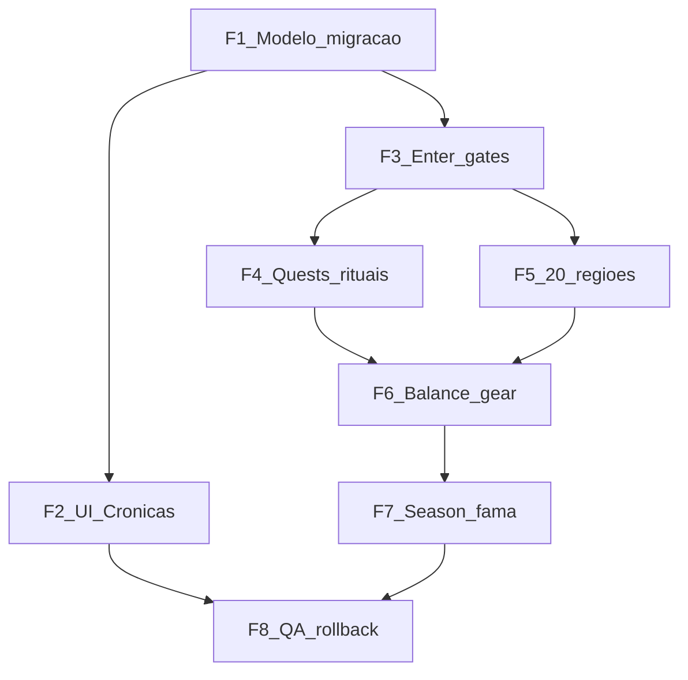

# 10 — Roadmap de implementação e decisões pendentes

**Status:** plano pós-documentação. **Não iniciar código sem aprovação das decisões abertas.**

---

## Regra atual

Implementação contínua do idle (farm, Celestial 700, Galeria, Admin). Quatro Eras **inexistente** no motor. Progressão 3.0 só em `docs/balanceamento/`.

## Proposta — fases verificáveis

Cada fase: entrega pequena + critério de aceite + dependência da anterior.

### Fase 1 — Modelagem e migração (schema)

- Blob `chapters` schemaVersion 1; dual-read; dry-run migração; snapshot.
- Soft reset season vs legacy especificado em código atrás da flag (ainda off).
- **Aceite:** testes T14–T15 dry-run; flag off = jogo idêntico.

### Fase 2 — Interface Crônicas (UI)

- Botão CAPÍTULOS; página 4 cards; estados; placeholders de arte.
- Consome API read-only de status (pode mockar se Fase 3 parcial).
- **Aceite:** mobile/desktop; bloqueado mostra requisitos; sem enter real ainda ou enter no-op seguro.

### Fase 3 — Navegação, progresso independente, unlock server

- `POST /chapters/enter`; farm stop; buckets isolados; gates zona×capítulo.
- Cap.I usa zonas atuais mapeadas mínimas.
- **Aceite:** T01, T06–T08, T19.

### Fase 4 — Missões e rituais

- Quests Cap.I–II com pity Suco; estender ritual Celestial; stubs Divino/Semideus.
- **Aceite:** T02–T05, T10.

### Fase 5 — Regiões temáticas

- 20 regiões (adapt+new); Admin `chapterId`; remap `farmZoneId`.
- **Aceite:** catálogo filtrável; nenhuma zona órfã.

### Fase 6 — Balance exponencial e equipamentos

- Bands Cap.II–IV; soft-cap gear; sinks; Cenário B no Cap.I se aprovado.
- Helpers numéricos / display pt-BR.
- **Aceite:** sims Cap.I≈B; TTK Cap.II sem skip com só gear Cap.I; T16.

### Fase 7 — Temporada e Galeria

- Soft reset chapters.season; conclusão Cap.IV → fame/cosmético; ranking 4 tiers.
- Offline 8h+decay **se** aprovado.
- **Aceite:** T11–T13; Semideus histórico não libera Cap.IV na season nova.

### Fase 8 — Testes integrados, responsividade, refino

- Matriz T01–T20; polish UI; rollback drill.
- **Aceite:** staging green; rollback documentado executado uma vez.

---

## Alterações necessárias (visão)

Código só após aprovar decisões abaixo. Ordem: schema → API → UI → conteúdo → balance → season → QA.

## Dependências externas

- Produção de artes dos 4 cards (pipeline arte).
- Aprovação de params Cenário B / offline 8h.
- Janela de comunicação a Celestiais L&gt;500.

## Impactos nos jogadores (go-live)

- Nova campanha sazonal; legado preservado conforme doc 01/09.
- Possível recalibração Cap.I (B) se ligado no mesmo release.

## Critérios de aceite deste documento

- [x] Roadmap 8 fases com dependências.
- [x] Lista de decisões ainda exigindo aprovação.
- [ ] Nenhuma fase de código iniciada sem sign-off.

## Migração / rollback

Ver [09](09_TESTES_E_MIGRACAO.md). Go-live = flag on pós dry-run. Rollback = flag off.

---

## Decisões que ainda exigem aprovação

Antes de implementar o sistema, confirmar:

1. **Compensação Celestial L501–700** — aceitar pacote canônico do doc 09 (ATK/HP% + unspent + título + mats) ou variante?
2. **Soft reset sazonal** — confirmar que **todo** Semideus recomeça campanha competitiva no Cap.I (legado só histórico/cosmético), sem “skip” por maxClassificationEver.
3. **Estender enum de ascensão** — `DIVINO` / `SEMIDEUS` no mesmo campo vs campo `classification` separado.
4. **Ativar Cenário B no Cap.I** no mesmo epic das Quatro Eras ou em PR separado?
5. **Offline 8 h + decay** — adotar na mesma leva ou manter 2 h até medição?
6. **Destino da zona `gelo`** — remap só farmZoneId vs manter bioma gelo opcional fora das 20?
7. **Hard vs soft gate de gear** nos chefes finais — soft (TTK) como doc 06 ou hard equip req?
8. **Magnitude layer** — implementar helper já na Fase 6 ou só quando Cap.III/IV cruzarem 1e15 em sim?
9. **Progressão 3.0 docs** — marcar oficialmente como superseded / arquivar ponteiro no README de balanceamento?
10. **Nome do item** — UX “Suco Divino” com id `consumable_suco_celestial` (sem rename de id) — OK?

---

## Entrega desta etapa (documentação)

| # | Arquivo | Conteúdo |
|---|---------|----------|
| 01 | [01_VISAO_GERAL.md](01_VISAO_GERAL.md) | Concepção, temporada vs legado |
| 02 | [02_NAVEGACAO_CAPITULOS.md](02_NAVEGACAO_CAPITULOS.md) | Crônicas / UX (spec only) |
| 03 | [03_REGIOES_E_CENARIOS.md](03_REGIOES_E_CENARIOS.md) | 20 regiões + mapa 17 |
| 04 | [04_QUESTS_E_RITUAIS.md](04_QUESTS_E_RITUAIS.md) | Transformações + pity |
| 05 | [05_PROGRESSAO_E_BALANCEAMENTO.md](05_PROGRESSAO_E_BALANCEAMENTO.md) | Math, 120d, Number limits |
| 06 | [06_EQUIPAMENTOS_E_ECONOMIA.md](06_EQUIPAMENTOS_E_ECONOMIA.md) | Soft-cap cross-chapter |
| 07 | [07_ARQUITETURA_E_PERSISTENCIA.md](07_ARQUITETURA_E_PERSISTENCIA.md) | Schema season/legacy |
| 08 | [08_IMPACTOS_NO_PROJETO.md](08_IMPACTOS_NO_PROJETO.md) | Módulos |
| 09 | [09_TESTES_E_MIGRACAO.md](09_TESTES_E_MIGRACAO.md) | Overflow + rollback |
| 10 | [10_ROADMAP_IMPLEMENTACAO.md](10_ROADMAP_IMPLEMENTACAO.md) | Este roadmap |

**Nenhum código, save, catálogo, HUD ou motor foi alterado nesta etapa.**
